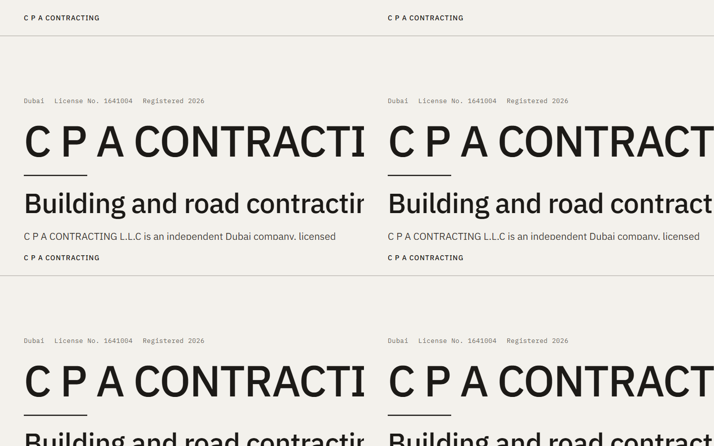
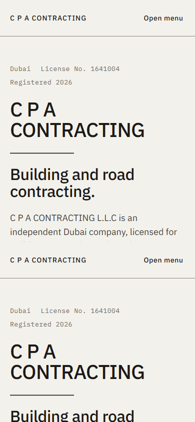

# Phase 03 — Implementation report

Date: 17 November 2026  
Scope: English homepage and frontend foundation for C P A CONTRACTING L.L.C.  
Status: ready for review. Phase 04 has not been started.

The page is the production build at `http://localhost:3456`.

## What was built

One route, `/`. Navigation is in-page anchors. There is no portfolio, no About, Services, Approach, Leadership, or Contact page, and no CMS.

Public facts on the page match the Phase 02.1 lock:

- Wordmark: `C P A CONTRACTING`
- Telephone: `+971 58 6524993`
- Managers: Karun Arora Arora — Manager; Vansh Arora — Manager
- Registered 2026
- License No. 1641004
- Commercial Register No. 2900890
- Licensed activities only: Building Contracting; Road Contracting

Email, domain, and office address are not published. No biographies, photographs, project names, client marks, awards, equipment, workforce figures, certifications, or testimonials.

## Files created

Application:

- `package.json`, `package-lock.json`
- `tsconfig.json`
- `next.config.ts`
- `eslint.config.mjs`
- `.gitignore`
- `README.md`
- `public/favicon.svg`
- `src/app/layout.tsx`
- `src/app/page.tsx`
- `src/app/globals.css`
- `src/app/actions.ts`
- `src/content/site.ts`
- `src/content/enquiry.ts`
- `src/components/site/SiteHeader.tsx`
- `src/components/site/SiteFooter.tsx`
- `src/components/home/HomeSections.tsx`
- `src/components/motion/HomeMotion.tsx`

Review assets:

- `phase-03-screenshots/desktop-1440-hero.png` (1440×900)
- `phase-03-screenshots/mobile-390-hero.png` (390×844)
- this report

## Components

| Piece | Role |
| --- | --- |
| `src/content/site.ts` | Public copy, navigation, telephone, licence facts |
| `src/content/enquiry.ts` | Form input and result types |
| `src/app/actions.ts` | Server action. Accepts a submission only when the endpoint returns success and `accepted: true` |
| `SiteHeader` / `SiteFooter` | Reusable chrome. Footer is asphalt and lists the legal line, licence, and telephone |
| `HomeSections` | Hero, two activities, company, approach, leadership, contact |
| `HomeMotion` | GSAP context. ScrollTrigger is created only when motion is allowed |
| `globals.css` | Tokens, type scale, layout, form, focus, reduced-motion scroll |

Typography classes are `.display-xl`, `.display-l`, `.display-m`, `.lead`, `.meta`, `.eyebrow`, `.button`, `.text-link`, and `.frame`.

## Design decisions

Direction is Measured Structure: paper ground, ink type, one asphalt band for Road Contracting, and copper only on the primary button and the focus ring.

- The wordmark is type. There is no symbol, emblem, or monogram. The favicon is a paper square with an ink rule.
- IBM Plex Sans and IBM Plex Mono are loaded with `next/font`. Commercial faces from the earlier shortlist are not shipped.
- The hero is one column until 1024px, then copy beside a line drawing. The drawing caption says it is not a photograph and not a project.
- Building Contracting sits on paper. Road Contracting sits on asphalt, with paper links, because `signal` fails contrast on that ground.
- Primary buttons are paper on `signal-deep` (`#F3F1EC` on `#8E4F2A`).
- The approach is four enquiry steps. The page states there is no project portfolio.
- Internal pages are not built. Header links jump to `#top`, `#company`, `#services`, `#approach`, `#leadership`, and `#contact`.

## Animation

Principle: Load → Align → Settle.

- On load, with motion allowed, the wordmark moves on the y axis, the rule scales from the left, and the hero lines stagger. Opacity stays at 1, so type is never hidden from assistive technology or from a user who tabs during the motion.
- The two activity bands move once when they enter the viewport.
- Below 1024px there is no pin. Chapters stay in normal document order. A “Skip approach” link goes to leadership.
- At 1024px and above, and only when `prefers-reduced-motion` is not reduce, the decorative spine scrubs and the rail pins for the length of the approach section. The text column is not pinned.
- `useGSAP` scopes the animation and reverts the context on unmount.
- With reduced motion, the rule and spine are set to their finished transforms and no ScrollTriggers are created.

Measured in the production page:

- 1440px, motion allowed: one `.pin-spacer`, heading opacity 1, no console errors.
- 1440px, `prefers-reduced-motion: reduce`: zero pin spacers, rule and spine at identity, heading visible.
- 390px: zero pin spacers.

There is no scroll hijacking, ScrollSmoother, SplitText, or WebGL.

## Responsive behaviour

- Below 900px the header shows the wordmark and an Open menu control. The open list stacks under that bar, left aligned, and includes the telephone. Escape sets `aria-expanded` back to false. At 390px the closed page does not overflow (`scrollWidth` 390).
- From 900px the menu control is hidden and the links sit on the header row, with the telephone at the right.
- 768px: menu control visible, navigation list hidden until opened, no horizontal overflow.
- 1024px and above: two-column hero, two-column facts and leadership, approach rail visible.
- 1440×900: no horizontal overflow. The display wordmark occupies x 48–863.

## Contact form

`ENQUIRY_ENDPOINT` is not set. The form is rendered with the approved fields and every control is disabled. The status text is:

“The enquiry form is not connected yet. It cannot confirm receipt. Call +971 58 6524993.”

The Send enquiry button is disabled. No accepted message is shown.

If an endpoint is configured later, `submitEnquiry` validates name, email, interest, and message, posts JSON, and returns `accepted` only when `response.ok` and `body.accepted === true`. Any other response, including a network failure, returns `rejected` or `invalid`.

## Accessibility checks

- Skip link “Skip to content” targets `#content` and can take focus.
- Focusable order on desktop, excluding disabled controls: skip link, wordmark, Home, About, Services, Approach, Leadership, Contact, header telephone, hero actions, activity links, company telephone and enquiry, skip approach, approach enquiry, leadership is text only, contact telephone, footer telephone. Disabled fields are omitted from that order.
- `:focus-visible` is a 2px `signal` outline with a 2px offset.
- One `h1`: “Building and road contracting.”
- Regions expose their headings. The menu button exposes expanded/collapsed and controls `site-nav`.
- Computed contrast on the live page: button 5.63:1 (paper on signal-deep), hero meta 4.76:1 (steel on paper), Road Contracting link 16.17:1 (paper on asphalt), footer link 7.05:1 (concrete on asphalt). Steel fact labels are the same steel token; the page ground behind them is paper.

A synthetic Tab key from the browser tool does not move DOM focus, so the Tab sequence was taken from the focusable elements in order, and the skip link was focused directly. Escape was confirmed: the menu button returned to `aria-expanded="false"`.

## Commands and results

All commands were run in this project on 17 November 2026.

| Command | Result |
| --- | --- |
| `npx next build` | Exit 0. Next.js 16.4.6 compiled, TypeScript finished, 3 static pages. Routes: `/` and `/_not-found`. |
| `npx tsc --noEmit` | Exit 0. |
| `npx eslint src` | Exit 0. |

Browser checks were against `npx next start -p 3456` after that build. Console error buffer after reload was empty at desktop and at 390px.

## Known limitations

- The enquiry form has no destination. It cannot confirm receipt until `ENQUIRY_ENDPOINT` is approved and set.
- No canonical URL, because the public domain is still deferred.
- Arabic is not loaded.
- No company photography. The drawing is abstract and labelled as such.
- Remaining sitemap pages, a CMS, analytics, and email delivery are out of this phase.
- Privacy copy for a live form is still open, and is not shown while the form is disconnected.

## Screenshots

Desktop hero, 1440×900:

Mobile hero, 390×844:

